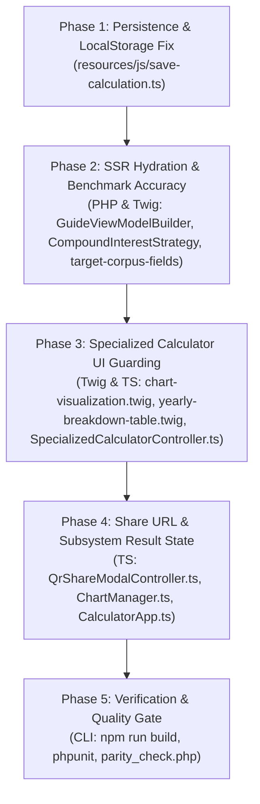

# Implementation Plan: Additional Calculator Regression & Quality Fixes (Part 2)

**Target Executor:** Junior Gemini 3.8 Flash Low (The Handoff Protocol)  
**Governing Standard:** `.agents/AGENTS.md` (Light-mode fintech aesthetic, POLA, Chesterton's Fence, Cross-Runtime Parity)  
**Scope:** Remediate 7 additional latent defects across all 16 dedicated calculators.

---

## Architectural Overview

This plan resolves the secondary batch of regression findings uncovered across state persistence, SSR hydration, benchmark templates, and specialized calculator state sharing:



---

## Proposed Changes

### Phase 1: LocalStorage "Save Plan" Input Selectors

#### Goal:
Ensure clicking "Save Plan" (`#saveCalculationBtn`) saves the actual user inputs rather than falling back to hardcoded ₹10,000 / 15Y defaults.

#### 1.1 `resources/js/save-calculation.ts`
- **File:** `resources/js/save-calculation.ts`
- **Action:** Query the active DOM input IDs (`sip`, `years`, `rate`, `stepup`, `enable_swp`, `summary-corpus`), and generate context-aware titles for SWP, Lumpsum, and Target Corpus.
- **Diff:**
```diff
--- a/resources/js/save-calculation.ts
+++ b/resources/js/save-calculation.ts
@@ -95,25 +95,44 @@ export function initSaveCalculationUI(): void {
         return;
     }
 
     saveBtn.addEventListener('click', () => {
-        const sipInput = document.getElementById('sip_amount') as HTMLInputElement | null;
-        const durationInput = document.getElementById('duration') as HTMLInputElement | null;
-        const rateInput = document.getElementById('interest_rate') as HTMLInputElement | null;
-        const stepUpInput = document.getElementById('step_up_pct') as HTMLInputElement | null;
-        const swpToggle = document.getElementById('swp_enabled') as HTMLInputElement | null;
-        const corpusDisplay = document.getElementById('summary-final-corpus') || document.getElementById('mini-hud-corpus');
+        const appEl = document.querySelector<HTMLElement>('[data-js="calculator-app"]');
+        const mode = appEl?.dataset?.mode || 'combo';
+
+        const sipInput = (document.getElementById('sip') || document.getElementById('sip_amount')) as HTMLInputElement | null;
+        const durationInput = (document.getElementById('years') || document.getElementById('duration')) as HTMLInputElement | null;
+        const rateInput = (document.getElementById('rate') || document.getElementById('interest_rate')) as HTMLInputElement | null;
+        const stepUpInput = (document.getElementById('stepup') || document.getElementById('step_up_pct')) as HTMLInputElement | null;
+        const swpToggle = (document.getElementById('enable_swp') || document.getElementById('swp_enabled')) as HTMLInputElement | null;
+        const corpusDisplay = document.getElementById('summary-corpus') || document.getElementById('summary-final-corpus') || document.getElementById('mini-hud-corpus');
 
-        const sip = sipInput ? parseFloat(sipInput.value) || 10000 : 10000;
+        const sip = sipInput ? parseFloat(sipInput.value) || 0 : 0;
         const duration = durationInput ? parseInt(durationInput.value, 10) || 15 : 15;
         const rate = rateInput ? parseFloat(rateInput.value) || 12 : 12;
         const stepUp = stepUpInput ? parseFloat(stepUpInput.value) || 0 : 0;
         const swpEnabled = swpToggle ? swpToggle.checked : false;
         const corpus = corpusDisplay ? corpusDisplay.textContent?.trim() || '' : '';
 
+        let title = '';
+        if (mode === 'swp') {
+            const swpWithdrawal = (document.getElementById('swp_withdrawal') as HTMLInputElement | null)?.value || '0';
+            title = `SWP ₹${parseFloat(swpWithdrawal).toLocaleString('en-IN')}/mo • ${duration}Y @ ${rate}%`;
+        } else if (mode === 'lumpsum') {
+            const lumpsumVal = (document.getElementById('lumpsum') as HTMLInputElement | null)?.value || '0';
+            title = `Lumpsum ₹${parseFloat(lumpsumVal).toLocaleString('en-IN')} • ${duration}Y @ ${rate}%`;
+        } else if (mode === 'target_corpus') {
+            const targetVal = (document.getElementById('target_corpus') as HTMLInputElement | null)?.value || '0';
+            title = `Target ₹${parseFloat(targetVal).toLocaleString('en-IN')} • ${duration}Y @ ${rate}%`;
+        } else {
+            title = `₹${sip.toLocaleString('en-IN')}/mo • ${duration}Y @ ${rate}%`;
+        }
+
         const success = saveCalculation({
-            title: `₹${sip.toLocaleString('en-IN')}/mo • ${duration}Y @ ${rate}%`,
-            calcType: 'sip_swp',
+            title: title,
+            calcType: mode,
             sipAmount: sip,
             sipDuration: duration,
             interestRate: rate,
```

---

### Phase 2: SSR Hydration & Benchmark Accuracy (PHP & Twig)

#### Goal:
1. Fix SSR hydration flash on `/reach-5-crore-via-sip` so the hero card outputs ~₹58,600 / mo without layout jump, and highlight the ₹5 Cr row in the benchmark matrix.
2. Fix benchmark table on `/compound-interest-calculator` so it renders compound interest matrix rather than SIP/SWP monthly pension table.

#### 2.1 `src/Services/GuideViewModelBuilder.php`
- **File:** `src/Services/GuideViewModelBuilder.php`
- **Action:** Calculate `target_calculated_sip` during SSR using `InvestmentCalculator::calculateRequiredSip`.
- **Diff:**
```diff
--- a/src/Services/GuideViewModelBuilder.php
+++ b/src/Services/GuideViewModelBuilder.php
@@ -94,6 +94,11 @@ class GuideViewModelBuilder
         $layout = ($type === 'calculator') ? 'calculators/calculator-guide' : 'layouts/generic-post';
 
         $targetCorpus = ($strategy instanceof \Core\Strategies\TargetCorpusStrategy) ? $strategy->getTargetCorpus() : null;
+        $targetCalculatedSip = null;
+        if ($strategy instanceof \Core\Strategies\TargetCorpusStrategy && $targetCorpus !== null && $initialInputs instanceof \Core\InvestmentInputs) {
+            $calc = new \Core\InvestmentCalculator();
+            $targetCalculatedSip = $calc->calculateRequiredSip($initialInputs, $targetCorpus);
+        }
         $all_posts = $this->blogRepository->getAllPosts();
         $related_calculators = $this->loadRelatedCalculators($fileSlug);
         $pillar_guides = $this->loadPillarGuides($fileSlug);
@@ -110,6 +115,7 @@ class GuideViewModelBuilder
             'benchmark_template'  => $strategy->getBenchmarkTemplate(),
             'benchmark_title'     => $strategy->getBenchmarkTitle(),
             'target_corpus'       => $targetCorpus,
+            'target_calculated_sip' => $targetCalculatedSip,
             'calc_config'         => $calcDefaults,
             'show_lumpsum'        => $show_lumpsum,
```

#### 2.2 `src/Views/components/forms/target-corpus-fields.twig`
- **File:** `src/Views/components/forms/target-corpus-fields.twig`
- **Action:** Use dynamic SSR `target_calculated_sip`.
- **Diff:**
```diff
--- a/src/Views/components/forms/target-corpus-fields.twig
+++ b/src/Views/components/forms/target-corpus-fields.twig
@@ -13,7 +13,7 @@
         </span>
         <span class="text-micro bg-growth-surface text-growth-emphasis px-2 py-0.5 rounded-full font-bold border border-growth-border">Inverse Math Solved</span>
     </div>
-    <div id="target_calculated_sip_display" class="text-heading-lg sm:text-display-xl font-extrabold text-growth-emphasis font-financial-mono mt-1.5 tabular-nums">₹ 11,516 / mo</div>
+    <div id="target_calculated_sip_display" class="text-heading-lg sm:text-display-xl font-extrabold text-growth-emphasis font-financial-mono mt-1.5 tabular-nums">₹ {{ (target_calculated_sip|default(11516))|number_format }} / mo</div>
     <p class="text-caption text-slate-600 mt-1">Systematically required monthly investment to achieve your target corpus.</p>
 </div>
```

#### 2.3 `src/Views/components/benchmarks/target-corpus.twig`
- **File:** `src/Views/components/benchmarks/target-corpus.twig`
- **Action:** Dynamically highlight the milestone row that matches `target_corpus`.
- **Diff:**
```diff
--- a/src/Views/components/benchmarks/target-corpus.twig
+++ b/src/Views/components/benchmarks/target-corpus.twig
@@ -27,7 +27,7 @@
                     <td class="py-3 px-3 sm:px-4 text-center text-slate-600">₹9,909 / mo</td>
                     <td class="py-3 px-3 sm:px-4 text-right font-bold text-emerald-800">₹5,004 / mo</td>
                 </tr>
-                <tr class="hover:bg-slate-50/50 transition-colors bg-emerald-50/30">
+                <tr class="hover:bg-slate-50/50 transition-colors bg-emerald-50/30 font-bold">
                     <td class="py-3 px-3 sm:px-4 font-bold text-slate-900 font-sans table-sticky-col-td">₹1.00 Crore</td>
                     <td class="py-3 px-3 sm:px-4 text-center text-slate-700">₹1,21,232 / mo</td>
                     <td class="py-3 px-3 sm:px-4 text-center font-extrabold text-emerald-800">₹43,041 / mo</td>
@@ -41,7 +41,7 @@
                     <td class="py-3 px-3 sm:px-4 text-center text-slate-600">₹39,637 / mo</td>
                     <td class="py-3 px-3 sm:px-4 text-right font-bold text-emerald-800">₹20,017 / mo</td>
                 </tr>
-                <tr class="hover:bg-slate-50/50 transition-colors">
+                <tr class="hover:bg-slate-50/50 transition-colors bg-emerald-50/30 font-bold">
                     <td class="py-3 px-3 sm:px-4 font-bold text-slate-900 font-sans table-sticky-col-td">₹5.00 Crore</td>
                     <td class="py-3 px-3 sm:px-4 text-center text-slate-700">₹6,06,161 / mo</td>
                     <td class="py-3 px-3 sm:px-4 text-center font-semibold text-emerald-700">₹2,15,203 / mo</td>
```

#### 2.4 `src/Core/Strategies/CompoundInterestStrategy.php`
- **File:** `src/Core/Strategies/CompoundInterestStrategy.php`
- **Action:** Override `getBenchmarkTemplate()` and `getBenchmarkTitle()`.
- **Diff:**
```diff
--- a/src/Core/Strategies/CompoundInterestStrategy.php
+++ b/src/Core/Strategies/CompoundInterestStrategy.php
@@ -24,4 +24,14 @@ class CompoundInterestStrategy extends BaseStrategy
 
         return new CompoundInterestInputs($principal, $rate, $years, $frequency);
     }
+
+    public function getBenchmarkTemplate(): string
+    {
+        return 'components/benchmarks/lumpsum-growth.twig';
+    }
+
+    public function getBenchmarkTitle(): string
+    {
+        return 'Compound Interest Growth Matrix (Principal Compounded @ 12% CAGR)';
+    }
 }
```

---

### Phase 3: Specialized Calculator UI Guarding (Twig & TypeScript)

#### Goal:
1. Suppress `#purchasing-power-telemetry-strip` (which shows `₹ --` and retirement copy) on specialized calculators.
2. Conditionally hide CSV & PDF export buttons on specialized calculators where backend endpoints only parse SIP/SWP inputs.

#### 3.1 `src/Views/components/chart-visualization.twig`
- **File:** `src/Views/components/chart-visualization.twig`
- **Action:** Wrap `#purchasing-power-telemetry-strip` in conditional checking for non-specialized calculators.
- **Diff:**
```diff
--- a/src/Views/components/chart-visualization.twig
+++ b/src/Views/components/chart-visualization.twig
@@ -64,6 +64,7 @@
         </div>
     </div>
 
+    
     <!-- Real Purchasing Power & Peace-of-Mind Telemetry Strip (Dynamic Risk Empathy) -->
     <div id="purchasing-power-telemetry-strip" class="p-3 sm:p-3.5 rounded-2xl bg-white/95 border border-slate-200/90 shadow-card flex flex-col sm:flex-row items-start sm:items-center justify-between gap-3 transition-all">
         <div class="flex items-start sm:items-center gap-3 min-w-0">
@@ -90,6 +91,7 @@
             </div>
         </div>
     </div>
+    
 
     <!-- Empathetic SWR Longevity Guardian Alert (Zero-CLS Container) -->
```

#### 3.2 `src/Views/components/yearly-breakdown-table.twig`
- **File:** `src/Views/components/yearly-breakdown-table.twig`
- **Action:** Conditionally hide CSV & PDF export buttons on specialized calculators.
- **Diff:**
```diff
--- a/src/Views/components/yearly-breakdown-table.twig
+++ b/src/Views/components/yearly-breakdown-table.twig
@@ -47,6 +47,7 @@
 
         <!-- Desktop Dispatch & Conversion Hub (High-Prominence Action Pod >= sm) -->
         <div class="hidden sm:flex flex-wrap items-center gap-2 w-full sm:w-auto justify-start sm:justify-end">
+            
             <!-- CSV Export Button -->
             <button type="submit" id="downloadCsvBtn" name="action" value="download_csv" form="calculator-form" formaction="/download-csv"
                 class="px-3.5 py-2 rounded-xl bg-growth-surface hover:bg-emerald-100 text-growth-emphasis border border-growth-border text-ui-xs font-extrabold transition-all duration-150 shadow-flat hover:shadow-subtle hover:border-emerald-300 active:scale-95 cursor-pointer flex items-center gap-1.5"
@@ -65,6 +66,7 @@
                 <span>🎨</span>
                 <span class="text-caption font-bold">Branded PDF</span>
             </button>
+            
 
             <!-- Save Plan to Browser Storage Button -->
```

#### 3.3 `assets/js/calculators/controllers/SpecializedCalculatorController.ts`
- **File:** `assets/js/calculators/controllers/SpecializedCalculatorController.ts`
- **Action:** Hide telemetry strip if present in the DOM during client-side hydration.
- **Diff:**
```diff
--- a/assets/js/calculators/controllers/SpecializedCalculatorController.ts
+++ b/assets/js/calculators/controllers/SpecializedCalculatorController.ts
@@ -88,6 +88,10 @@ export class SpecializedCalculatorController {
             summaryGrid.className = 'grid grid-cols-2 sm:grid-cols-3 gap-3 transition-all duration-300';
             cardWithdrawn.classList.add('hidden');
         }
+        const telemetryStrip = this.dom.getElement('purchasing-power-telemetry-strip');
+        if (telemetryStrip) {
+            telemetryStrip.classList.add('hidden');
+        }
     }
 
     private bindFormListeners(): void {
```

---

### Phase 4: Share URL & Subsystem Result State (TypeScript)

#### Goal:
1. In `QrShareModalController.ts`, serialize specialized form parameters into share links when in specialized mode.
2. In `ChartManager.ts`, expose `getLastResults()`, and fall back to it in `CalculatorApp.ts` so `this.chartScrubbingController`, snapshot diffs, and WhatsApp share receive the calculated data on specialized calculators.

#### 4.1 `assets/js/calculators/controllers/QrShareModalController.ts`
- **File:** `assets/js/calculators/controllers/QrShareModalController.ts`
- **Action:** Serialize specialized form parameters when in specialized mode.
- **Diff:**
```diff
--- a/assets/js/calculators/controllers/QrShareModalController.ts
+++ b/assets/js/calculators/controllers/QrShareModalController.ts
@@ -121,6 +121,24 @@ export class QrShareModalController {
         try {
+            const appEl = this.dom.getElement('calculator-app') || document.querySelector<HTMLElement>('[data-js="calculator-app"]');
+            const mode = appEl?.dataset?.mode;
+            const specializedModes = ['compound_interest', 'cagr', 'emi', 'inflation', 'ppf', 'fd'];
+
+            if (mode && specializedModes.includes(mode)) {
+                const form = this.dom.getElement<HTMLFormElement>('calculator-form');
+                if (form) {
+                    const formData = new FormData(form);
+                    const params = new URLSearchParams();
+                    formData.forEach((val, key) => {
+                        const strVal = String(val).trim();
+                        if (strVal !== '' && key !== 'website_url' && !['sip', 'stepup', 'lumpsum', 'enable_swp'].includes(key)) {
+                            params.set(key, strVal);
+                        }
+                    });
+                    const queryString = params.toString();
+                    return queryString ? `${window.location.origin}${window.location.pathname}?${queryString}` : window.location.href;
+                }
+            }
+
             const inputs = this.getInputs();
             const params = new URLSearchParams();
-            const appEl = this.dom.getElement('calculator-app');
             const isSwpMode = (appEl?.dataset?.mode === 'swp');
```

#### 4.2 `assets/js/calculators/ChartManager.ts`
- **File:** `assets/js/calculators/ChartManager.ts`
- **Action:** Expose public getter `getLastResults(): YearResult[]`.
- **Diff:**
```diff
--- a/assets/js/calculators/ChartManager.ts
+++ b/assets/js/calculators/ChartManager.ts
@@ -79,6 +79,13 @@ export class ChartManager {
         this.initEventSubscriptions();
     }
 
+    /**
+     * Returns the most recent calculation results schedule.
+     */
+    public getLastResults(): YearResult[] {
+        return this.lastResults;
+    }
+
     /**
      * Subscribes to global EventBus topics to achieve loose coupling.
      */
```

#### 4.3 `assets/js/calculators/CalculatorApp.ts`
- **File:** `assets/js/calculators/CalculatorApp.ts`
- **Action:** Use `this.latestResults.length > 0 ? this.latestResults : this.chartManager.getLastResults()` in subsystem initializers.
- **Diff:**
```diff
--- a/assets/js/calculators/CalculatorApp.ts
+++ b/assets/js/calculators/CalculatorApp.ts
@@ -118,7 +118,7 @@ export class CalculatorApp {
             formatter: this.formatter,
             chartManager: this.chartManager,
             analytics: this.analytics,
             getInputs: () => this.getInputs(),
-            getLatestResults: () => this.latestResults,
+            getLatestResults: () => this.latestResults.length > 0 ? this.latestResults : this.chartManager.getLastResults(),
             getActiveGoalMode: () => this.activeGoalMode,
             getInteractionCount: () => this.interactionCount
         });
@@ -130,7 +130,7 @@ export class CalculatorApp {
             analytics: this.analytics,
             triggerCalculation: () => this.triggerCalculation(),
             getInputs: () => this.getInputs(),
-            getLatestResults: () => this.latestResults,
+            getLatestResults: () => this.latestResults.length > 0 ? this.latestResults : this.chartManager.getLastResults(),
             onSmartNudgeRate: (rate) => this.setSmartNudgeRate(rate)
         });
```

---

## Phase 5: Verification & Parity Gate Plan

1. **Parity Check:**
   ```bash
   PATH="/Users/sumeetboga/.nvm/versions/node/v24.14.0/bin:$PATH" php tests/parity_check.php
   ```
2. **TypeScript & Bundling Check:**
   ```bash
   npm run build
   ```
3. **PHPUnit Unit Tests:**
   ```bash
   PATH="/Users/sumeetboga/.nvm/versions/node/v24.14.0/bin:$PATH" vendor/bin/phpunit --testsuite Unit
   ```
4. **PHPStan & PHPCS:**
   ```bash
   php -d memory_limit=1G vendor/bin/phpstan analyse src/Services/GuideViewModelBuilder.php src/Core/Strategies/CompoundInterestStrategy.php --debug
   vendor/bin/phpcs src/Services/GuideViewModelBuilder.php src/Core/Strategies/CompoundInterestStrategy.php
   ```
5. **Handoff Ledger Protocol:** Update `.agents/memory/activeContext.md`.
