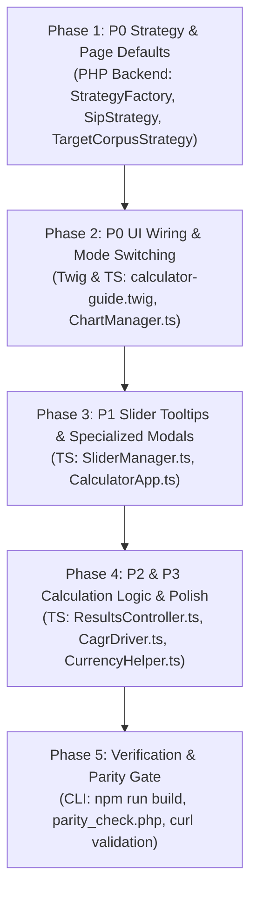

# Implementation Plan: Calculator Regression & Defect Remediation

**Target Executor:** Junior Gemini 3.8 Flash Low (The Handoff Protocol)  
**Governing Standard:** `.agents/AGENTS.md` (Light-mode fintech aesthetic, POLA, Chesterton's Fence, Cross-Runtime Parity)  
**Scope:** Remediate 11 confirmed defects across all 16 dedicated calculators without touching the homepage master calculator.

---

## Architectural Overview & Execution Strategy

Our regression audit confirmed **100% mathematical parity** between PHP and TypeScript calculation engines (`tests/parity_check.php` passes all scenarios). However, the UI orchestration, template structures, initial strategy inputs, and event listeners suffer from 11 specific defects ranging from critical lockout to tooltip glitches.

To ensure seamless execution by a junior model without rabbit holes or regressions, this plan organizes the fixes into **5 atomic, sequential phases**:



---

## Proposed Changes

### Phase 1: P0 Route & Strategy Initial Defaults (PHP Backend)

#### Goal:
Ensure `/reach-5-crore-via-sip` initializes to ₹5 Crore (not ₹1 Crore), and `/sip-5000-per-month` initializes to ₹5,000 (not ₹10,000), matching their SEO titles, content, and mathematical matrices.

---

#### 1.1 `src/Core/Strategies/SipStrategy.php`
- **File:** `src/Core/Strategies/SipStrategy.php`
- **Action:** Support an optional `$defaultSip` constructor override so specific slugs can supply custom starting monthly amounts.
- **Diff:**
```diff
--- a/src/Core/Strategies/SipStrategy.php
+++ b/src/Core/Strategies/SipStrategy.php
@@ -4,10 +4,28 @@ declare(strict_types=1);
 
 namespace Core\Strategies;
 
+use Core\Inputs\CalculatorInputsInterface;
+use Core\InvestmentInputs;
+use Services\ConfigServiceInterface;
+
 class SipStrategy extends BaseStrategy
 {
+    private ?float $defaultSip;
+
+    public function __construct(ConfigServiceInterface $configService, ?float $defaultSip = null)
+    {
+        parent::__construct($configService);
+        $this->defaultSip = $defaultSip;
+    }
+
     public function getType(): string
     {
         return 'sip';
     }
+
+    public function getInitialInputs(): CalculatorInputsInterface
+    {
+        $overrides = $this->defaultSip !== null ? ['sip' => $this->defaultSip] : [];
+        return InvestmentInputs::fromRequest($overrides, $this->configService);
+    }
 }
```

---

#### 1.2 `src/Core/Strategies/TargetCorpusStrategy.php`
- **File:** `src/Core/Strategies/TargetCorpusStrategy.php`
- **Action:** Support custom `$defaultTargetCorpus` and expose a getter `getTargetCorpus(): float`.
- **Diff:**
```diff
--- a/src/Core/Strategies/TargetCorpusStrategy.php
+++ b/src/Core/Strategies/TargetCorpusStrategy.php
@@ -4,9 +4,23 @@ declare(strict_types=1);
 
 namespace Core\Strategies;
 
+use Services\ConfigServiceInterface;
+
 class TargetCorpusStrategy extends BaseStrategy
 {
+    private float $defaultTargetCorpus;
+
+    public function __construct(ConfigServiceInterface $configService, float $defaultTargetCorpus = 10000000.0)
+    {
+        parent::__construct($configService);
+        $this->defaultTargetCorpus = $defaultTargetCorpus;
+    }
+
+    public function getTargetCorpus(): float
+    {
+        return $this->defaultTargetCorpus;
+    }
+
     public function getType(): string
     {
         return 'target_corpus';
```

---

#### 1.3 `src/Core/Strategies/StrategyFactory.php`
- **File:** `src/Core/Strategies/StrategyFactory.php`
- **Action:** Pass customized constructor parameters for `sip-5000-per-month` (5,000) and `reach-5-crore-via-sip` (50,000,000).
- **Diff:**
```diff
--- a/src/Core/Strategies/StrategyFactory.php
+++ b/src/Core/Strategies/StrategyFactory.php
@@ -57,6 +57,14 @@ class StrategyFactory
         if (!isset($this->strategyMap[$key])) {
             throw new \DomainException("No calculator strategy mapped for slug: '{$key}'");
         }
+
+        if ($key === 'sip-5000-per-month') {
+            return new SipStrategy($this->configService, 5000.0);
+        }
+        if ($key === 'reach-5-crore-via-sip') {
+            return new TargetCorpusStrategy($this->configService, 50000000.0);
+        }
+
         $strategyClass = $this->strategyMap[$key];
```

---

#### 1.4 `src/Services/GuideViewModelBuilder.php`
- **File:** `src/Services/GuideViewModelBuilder.php`
- **Action:** Pass `target_corpus` into `$data` for the Twig template.
- **Diff:**
```diff
--- a/src/Services/GuideViewModelBuilder.php
+++ b/src/Services/GuideViewModelBuilder.php
@@ -93,6 +93,7 @@ class GuideViewModelBuilder
         $show_lumpsum = ($calculator_type === 'lumpsum');
         $layout = ($type === 'calculator') ? 'calculators/calculator-guide' : 'layouts/generic-post';
 
+        $targetCorpus = ($strategy instanceof \Core\Strategies\TargetCorpusStrategy) ? $strategy->getTargetCorpus() : null;
         $all_posts = $this->blogRepository->getAllPosts();
         $related_calculators = $this->loadRelatedCalculators($fileSlug);
         $pillar_guides = $this->loadPillarGuides($fileSlug);
@@ -108,6 +109,7 @@ class GuideViewModelBuilder
             'calculator_type'     => $calculator_type,
             'benchmark_template'  => $strategy->getBenchmarkTemplate(),
             'benchmark_title'     => $strategy->getBenchmarkTitle(),
+            'target_corpus'       => $targetCorpus,
             'calc_config'         => $calcDefaults,
             'show_lumpsum'        => $show_lumpsum,
```

---

### Phase 2: P0 UI Wiring & Mode Switching (Twig & TypeScript)

#### Goal:
1. Fix permanent lockout on `/retirement-calculator` by rendering the 3-mode segmented control bar.
2. Fix dead clicks on donut view and benchmark chips across ALL calculators by calling `chartManager.initControls()`.

---

#### 2.1 `src/Views/calculators/calculator-guide.twig`
- **File:** `src/Views/calculators/calculator-guide.twig`
- **Action:** Replace the 2-button tabs in combo mode with the proper 3-button segmented control bar matching `calculator-form.twig`, including stage headers and divider.
- **Diff:**
```diff
--- a/src/Views/calculators/calculator-guide.twig
+++ b/src/Views/calculators/calculator-guide.twig
@@ -134,22 +134,39 @@
                 <form id="calculator-form" class="relative z-10 space-y-3 flex-1 min-h-0 overflow-y-auto overflow-x-hidden custom-scrollbar pr-1.5 scroll-smooth" onsubmit="event.preventDefault();">
                     
-                        <!-- Combo Form (SIP + SWP Tabs) -->
+                        <!-- 3-Mode Segmented Control Bar (Dual vs SIP Only vs SWP Only) -->
                         <div class="py-0.5 mb-2 rounded-2xl">
-                            <div class="flex bg-slate-100/90 p-1 rounded-2xl border border-slate-200/70 shadow-flat gap-1" role="tablist">
-                                <button type="button" id="tab-sip" role="tab" aria-selected="true"
-                                    class="flex-1 flex items-center justify-center gap-1.5 py-2 px-1 text-ui-xs font-bold uppercase tracking-wider rounded-xl transition-all duration-200 bg-white text-growth-emphasis shadow-flat border border-slate-200/60 cursor-pointer">
-                                    <span>⚡</span>
-                                    <span>SIP Details</span>
+                            <div class="flex bg-slate-100/90 p-1 rounded-2xl border border-slate-200/70 shadow-flat gap-1" role="tablist" aria-label="Calculator Mode Selector">
+                                <button type="button" id="tab-combo" role="tab" aria-selected="true"
+                                    class="flex-1 flex items-center justify-center gap-1.5 py-2 px-1 text-ui-xs font-extrabold uppercase tracking-wider rounded-xl transition-all duration-200 bg-white text-emerald-800 shadow-flat border border-slate-200/60 cursor-pointer">
+                                    <span class="flex items-center justify-center w-4 h-4 rounded-full bg-emerald-100 text-emerald-800 text-micro font-extrabold">🚀</span>
+                                    <span>Dual (SIP+SWP)</span>
+                                </button>
+                                <button type="button" id="tab-sip" role="tab" aria-selected="false"
+                                    class="flex-1 flex items-center justify-center gap-1.5 py-2 px-1 text-ui-xs font-bold uppercase tracking-wider rounded-xl transition-all duration-200 text-slate-500 hover:text-slate-900 cursor-pointer">
+                                    <span class="flex items-center justify-center w-4 h-4 rounded-full bg-slate-200 text-slate-600 text-micro font-extrabold">⚡</span>
+                                    <span>SIP Only</span>
                                 </button>
                                 <button type="button" id="tab-swp" role="tab" aria-selected="false"
                                     class="flex-1 flex items-center justify-center gap-1.5 py-2 px-1 text-ui-xs font-bold uppercase tracking-wider rounded-xl transition-all duration-200 text-slate-500 hover:text-slate-900 cursor-pointer">
-                                    <span>🛡️</span>
-                                    <span>SWP Details</span>
+                                    <span class="flex items-center justify-center w-4 h-4 rounded-full bg-slate-200 text-slate-600 text-micro font-extrabold">🛡️</span>
+                                    <span>SWP Only</span>
                                 </button>
                             </div>
                         </div>
                         
                         <div id="panel-sip" role="tabpanel" aria-labelledby="tab-sip">
+                            <div id="stage-1-header" class="flex items-center justify-between px-3 py-1.5 mb-2 rounded-xl bg-gradient-to-r from-emerald-50 via-teal-50/50 to-slate-50 border border-emerald-200/80 shadow-flat">
+                                <div class="flex items-center gap-2">
+                                    <span class="flex items-center justify-center w-4 h-4 rounded-full bg-emerald-600 text-white text-micro font-black">1</span>
+                                    <span class="text-caption font-extrabold text-emerald-950 uppercase tracking-wider">Accumulation Phase (SIP)</span>
+                                </div>
+                                <span class="text-micro font-bold text-emerald-700 font-financial-mono">Wealth Building</span>
+                            </div>
                             <div class="space-y-3">
                                 
                             </div>
                         </div>
                         
-                        <div id="panel-swp" role="tabpanel" aria-labelledby="tab-swp" class="hidden">
+                        <div id="stage-transition-divider" class="my-3 flex items-center gap-2">
+                            <div class="flex-1 border-t border-dashed border-slate-300"></div>
+                            <span class="text-micro font-bold uppercase tracking-widest text-slate-400 bg-slate-50 px-2 py-0.5 rounded-full border border-slate-200">Retirement Transition</span>
+                            <div class="flex-1 border-t border-dashed border-slate-300"></div>
+                        </div>
+
+                        <div id="panel-swp" role="tabpanel" aria-labelledby="tab-swp">
+                            <div id="stage-2-header" class="flex items-center justify-between px-3 py-1.5 mb-2 rounded-xl bg-gradient-to-r from-rose-50 via-amber-50/50 to-slate-50 border border-rose-200/80 shadow-flat">
+                                <div class="flex items-center gap-2">
+                                    <span class="flex items-center justify-center w-4 h-4 rounded-full bg-rose-600 text-white text-micro font-black">2</span>
+                                    <span class="text-caption font-extrabold text-rose-950 uppercase tracking-wider">Distribution Phase (SWP)</span>
+                                </div>
+                                <span class="text-micro font-bold text-rose-700 font-financial-mono">Retirement Cashflow</span>
+                            </div>
+                            <div id="swp-standalone-corpus" class="hidden mb-3">
+                                
+                            </div>
                             <div class="space-y-3">
```

---

#### 2.2 `assets/js/calculators/CalculatorApp.ts`
- **File:** `assets/js/calculators/CalculatorApp.ts`
- **Action:** Call `this.chartManager.initControls()` at the top of `init()` so that chart view toggles and benchmark chips are wired on every calculator.
- **Diff:**
```diff
--- a/assets/js/calculators/CalculatorApp.ts
+++ b/assets/js/calculators/CalculatorApp.ts
@@ -507,6 +507,9 @@ export class CalculatorApp {
         const mode = appEl?.dataset?.mode || 'combo';
         const specializedModes = ['compound_interest', 'cagr', 'emi', 'inflation', 'ppf', 'fd'];
 
+        // Bind view switcher (line/donut) and benchmark chips across all calculators
+        this.chartManager.initControls();
+
         if (specializedModes.includes(mode)) {
             new StepperController(
```

---

### Phase 3: P1 Slider Tooltips & Specialized Modals (TypeScript)

#### Goal:
1. Fix slider drag tooltips on all 6 specialized calculators so currency fields display `₹X Lakh / Crore` instead of `3000000%`, and tenure sliders display `X Yrs` instead of `X%`.
2. Initialize `ExportSubsystem` and `ErgonomicsSubsystem` on specialized calculators so "Share Plan", QR code modal, and keyboard shortcuts function properly.

---

#### 3.1 `assets/js/calculators/SliderManager.ts`
- **File:** `assets/js/calculators/SliderManager.ts`
- **Action:** Expand tooltip formatting rules to detect currency and year inputs across standard and specialized calculators.
- **Diff:**
```diff
--- a/assets/js/calculators/SliderManager.ts
+++ b/assets/js/calculators/SliderManager.ts
@@ -168,9 +168,13 @@ export class SliderManager {
             const max = parseFloat(range.max) || 100;
             const pct = max > min ? ((val - min) / (max - min)) * 100 : 0;
             tooltip.style.left = `clamp(32px, ${pct.toFixed(2)}%, calc(100% - 32px))`;
-            if (inputId === 'sip' || inputId === 'lumpsum' || inputId === 'target_corpus' || inputId === 'swp_withdrawal') {
+            
+            const isCurrency = inputId === 'sip' || inputId === 'lumpsum' || inputId === 'target_corpus' || inputId === 'swp_withdrawal' ||
+                inputId.endsWith('_principal') || inputId.endsWith('_deposit') || inputId.endsWith('_amount') || inputId.endsWith('_initial') || inputId.endsWith('_final');
+            const isYears = inputId === 'years' || inputId === 'swp_years' || inputId.endsWith('_years');
+
+            if (isCurrency) {
                 tooltip.textContent = this.formatter.formatDynamic(val);
-            } else if (inputId === 'years' || inputId === 'swp_years') {
+            } else if (isYears) {
                 tooltip.textContent = `${val} Yrs`;
             } else {
                 tooltip.textContent = `${val}%`;
```

---

#### 3.2 `assets/js/calculators/CalculatorApp.ts`
- **File:** `assets/js/calculators/CalculatorApp.ts`
- **Action:** Initialize `exportSubsystem` and `ergonomicsSubsystem` before returning in specialized calculator mode.
- **Diff:**
```diff
--- a/assets/js/calculators/CalculatorApp.ts
+++ b/assets/js/calculators/CalculatorApp.ts
@@ -530,6 +530,8 @@ export class CalculatorApp {
                 this.analytics
             );
             this.specializedController.init();
+            this.exportSubsystem.init();
+            this.ergonomicsSubsystem.init();
             return;
         }
```

---

### Phase 4: P2 & P3 Calculation Logic, Formatting & Microcopy Polish

#### Goal:
1. Prevent spurious "Compounding Ignition" row in Year 2 on Lumpsum, SWP, and Specialized calculators.
2. Fix double-sign `+-40.0%` on CAGR negative returns.
3. Conditionally suppress equity tax lenses on PPF, FD, and EMI calculators in Twig.
4. Add Indian currency subtext and assistive voice labels for specialized fields in `CurrencyHelper.ts`.
5. Fix Step-Up boost button to increment rather than reset to 10.

---

#### 4.1 `assets/js/calculators/controllers/ResultsController.ts`
- **File:** `assets/js/calculators/controllers/ResultsController.ts`
- **Action:** Restrict Compounding Ignition ribbon strictly to SIP accumulation mode when annual contributions and SIP are positive.
- **Diff:**
```diff
--- a/assets/js/calculators/controllers/ResultsController.ts
+++ b/assets/js/calculators/controllers/ResultsController.ts
@@ -314,7 +314,8 @@ export class ResultsController {
             }
 
             // Detect and inject Compounding Ignition Inflection Ribbon Row
-            if (!ignitionRendered && (row.interest ?? 0) >= (row.annual_contribution ?? 0) && row.year > 1 && row.cumulative_invested > 0) {
+            const isAccumulation = !inputs.enable_swp && (inputs.sip ?? 0) > 0 && (row.annual_contribution ?? 0) > 0;
+            if (isAccumulation && !ignitionRendered && (row.interest ?? 0) >= (row.annual_contribution ?? 0) && row.year > 1 && row.cumulative_invested > 0) {
                 ignitionRendered = true;
                 const inflectionTr = document.createElement('tr');
                 inflectionTr.className = 'bg-emerald-50/80 border-y border-emerald-300/80 font-sans';
```

---

#### 4.2 `assets/js/calculators/drivers/CagrDriver.ts`
- **File:** `assets/js/calculators/drivers/CagrDriver.ts`
- **Action:** Avoid hardcoded `+` prefix when absolute return is negative.
- **Diff:**
```diff
--- a/assets/js/calculators/drivers/CagrDriver.ts
+++ b/assets/js/calculators/drivers/CagrDriver.ts
@@ -60,7 +60,9 @@ export class CagrDriver implements ISpecializedDriver {
 
         const gainBadge = ctx.dom.getElement('summary-gain-badge');
         if (gainBadge) {
-            gainBadge.textContent = `+${res.absolute_return_percentage.toFixed(1)}% (${res.multiplier.toFixed(2)}x)`;
+            const pct = res.absolute_return_percentage;
+            const sign = pct >= 0 ? '+' : '';
+            gainBadge.textContent = `${sign}${pct.toFixed(1)}% (${res.multiplier.toFixed(2)}x)`;
         }
 
         ctx.resultsController.updateTable(combined, false);
```

---

#### 4.3 `assets/js/calculators/CurrencyHelper.ts`
- **File:** `assets/js/calculators/CurrencyHelper.ts`
- **Action:** Add subtext and ARIA formatting support for specialized fields (`_principal`, `_deposit`, `_amount`, `_initial`, `_final`, `_years`, `_rate`).
- **Diff:**
```diff
--- a/assets/js/calculators/CurrencyHelper.ts
+++ b/assets/js/calculators/CurrencyHelper.ts
@@ -144,8 +144,16 @@ export class CurrencyFormatter {
             return this.formatDynamic(value);
         }
 
-        if (fieldId === 'years' || fieldId === 'swp_years') {
+        if (fieldId.endsWith('_principal') || fieldId.endsWith('_deposit') || fieldId.endsWith('_amount') || fieldId.endsWith('_initial') || fieldId.endsWith('_final')) {
+            return this.formatDynamic(value);
+        }
+
+        if (fieldId === 'years' || fieldId === 'swp_years' || fieldId.endsWith('_years')) {
             const months = value * 12;
             return `${value} Year${value > 1 ? 's' : ''} (${months} Months)`;
         }
+
+        if (fieldId.endsWith('_rate')) {
+            return `${value.toFixed(1).replace(/\.0$/, '')}% p.a.`;
+        }
```

---

#### 4.4 `assets/js/calculators/CalculatorApp.ts` (Step-Up Boost Button)
- **File:** `assets/js/calculators/CalculatorApp.ts`
- **Action:** Increment step-up by +5% if already active, instead of resetting to 10.
- **Diff:**
```diff
--- a/assets/js/calculators/CalculatorApp.ts
+++ b/assets/js/calculators/CalculatorApp.ts
@@ -580,7 +580,9 @@ export class CalculatorApp {
         const stepupBoostBtn = this.dom.getElement<HTMLButtonElement>('apply-10pct-stepup-btn');
         if (stepupBoostBtn) {
             stepupBoostBtn.addEventListener('click', () => {
-                this.sliderManager.updateFieldValue('stepup', 10);
+                const current = parseFloat(this.dom.getValue('stepup') || '0') || 0;
+                const nextVal = current === 0 ? 10 : Math.min(25, current + 5);
+                this.sliderManager.updateFieldValue('stepup', nextVal);
                 this.triggerCalculation();
                 this.engagementSubsystem.triggerMicroBurst();
-                A11yAnnouncer.announce('Applied 10% annual salary appraisal step-up');
+                A11yAnnouncer.announce(`Applied salary step-up: ${nextVal}%`);
             });
         }
```

---

#### 4.5 `src/Views/components/chart-visualization.twig`
- **File:** `src/Views/components/chart-visualization.twig`
- **Action:** Conditionally hide Section 112A equity capital gains tax toggle on fixed-income/debt products (PPF, FD, EMI).
- **Diff:**
```diff
--- a/src/Views/components/chart-visualization.twig
+++ b/src/Views/components/chart-visualization.twig
@@ -282,6 +282,7 @@
                 <span id="active-lens-indicator" class="hidden sm:inline-flex items-center text-micro font-bold text-slate-500 bg-slate-100/90 px-2 py-0.5 rounded-full border border-slate-200/70 shrink-0">Standard View</span>
 
+                
                 <!-- Lens: Section 112A LTCG Tax -->
                 <label id="overlay-chip-post-tax" 
                     class="group relative inline-flex items-center gap-1.5 px-3 py-2 sm:py-1 min-h-[44px] sm:min-h-0 rounded-xl sm:rounded-lg cursor-pointer select-none transition-all duration-150 text-caption font-semibold text-slate-600 hover:text-slate-900 bg-slate-50 hover:bg-white active:scale-95 border border-slate-200/80 has-checked:bg-white has-checked:text-tax-emphasis has-checked:shadow-flat has-checked:border-tax-border has-checked:font-bold shrink-0" 
@@ -290,6 +291,7 @@
                     <span>§112A LTCG</span>
                     <span id="tax-telemetry-pill" class="px-1.5 py-0.2 rounded bg-slate-200/60 peer-checked:bg-tax-surface text-micro font-financial-mono text-slate-600 peer-checked:text-tax-emphasis font-bold">12.5%</span>
                 </label>
+                
 
                 <!-- Lens: Corridor -->
```

---

## Phase 5: Verification & Quality Gate Plan

To be executed immediately following the changes:

### 1. Mathematical Parity Check
Run the cross-runtime parity suite with NVM Node path:
```bash
PATH="/Users/sumeetboga/.nvm/versions/node/v24.14.0/bin:$PATH" php tests/parity_check.php
```
*Expected Result:* 0 failures, all 20 forward scenarios + 5 inverse solver tests + 37 specialized tests pass.

### 2. Frontend TypeScript Build & Bundling
```bash
npm run build
```
*Expected Result:* 0 TypeScript compiler errors, clean bundle emitted into `dist/`.

### 3. PHPUnit Unit Tests
```bash
vendor/bin/phpunit --testsuite Unit
```
*Expected Result:* All unit tests pass with zero errors.

### 4. Route Defaults Verification (DOM checks)
Test rendering and initial values for critical URLs:
```bash
php -r "
require 'vendor/autoload.php';
\$app = (require 'src/bootstrap.php');
// Test StrategyFactory for sip-5000
\$sf = \$app->get(\Core\Strategies\StrategyFactory::class);
\$sipStrategy = \$sf->create('sip-5000-per-month');
assert(\$sipStrategy->getInitialInputs()->toTemplateData()['sip'] === 5000.0, 'SIP 5000 strategy failed');
// Test StrategyFactory for reach-5-crore
\$croreStrategy = \$sf->create('reach-5-crore-via-sip');
assert(\$croreStrategy->getTargetCorpus() === 50000000.0, 'Reach 5 Crore strategy failed');
echo 'StrategyFactory checks PASSED\n';
"
```

---

## Retrospective & Guardrail Compliance Check
- **Pure Light Mode Theme:** All modified Twig markup strictly uses light classes (`bg-white`, `border-slate-200`, `text-slate-900`, `bg-emerald-50`, `text-emerald-800`). Zero dark containers introduced.
- **Zero Hallucination / POLA:** No magic string heuristics or hacks; strategy parameters and Twig state are explicit.
- **Documentation Anti-Drift:** Update `.agents/memory/activeContext.md` upon completion.

